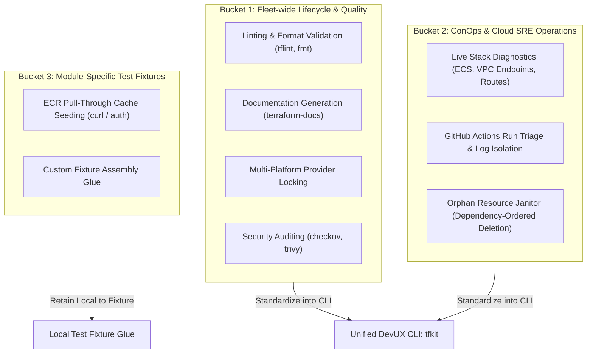
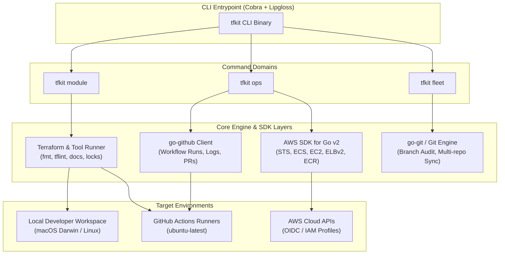
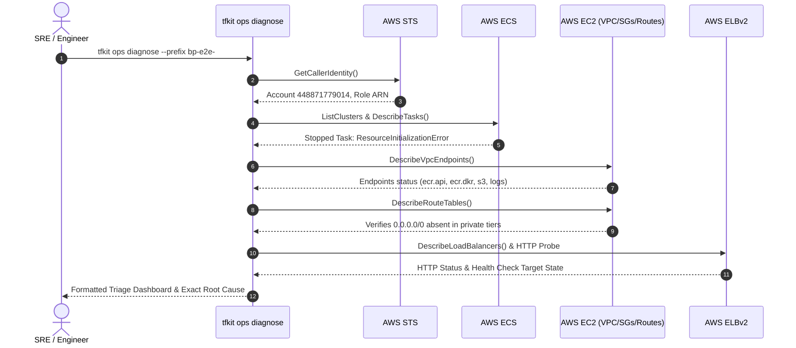
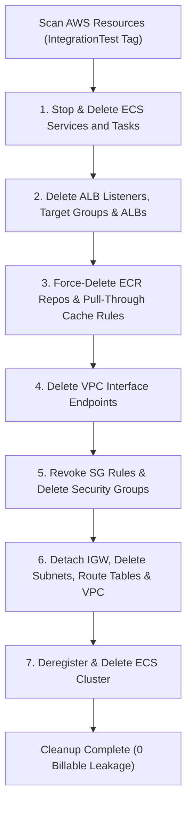

# RFC: Unified DevUX & SRE ConOps CLI (`tfkit`) for Multi-Repo Terraform Platforms

**Status:** Draft / Proposed Architecture
**Author:** Staff Platform Engineer / SRE Architecture Review
**Target Fleet:** `github.com/hatan4ik/aws.modules.*` (13+ Repositories) & Platform Infra

---

## 1. Executive Summary & Problem Statement

Across the 13+ repositories in the `aws.modules.*` catalog, developers and automation rely on dozens of disparate Bash and Python scripts located in `scripts/` directories:

- `check-listener-ordering.sh` (Listener sequence verification)
- `integration-e2e.sh` (Multi-root Terraform apply and verification)
- `import-image.sh` (ECR Pull-Through Cache curl priming)
- `diagnose-integration-stack.sh` (Live AWS EC2/ECS/VPC endpoint inspector)
- `triage-integration-run.sh` (GitHub Actions workflow failure extractor)
- `cleanup-integration-stack.sh` (Orphan AWS resource cleaner)

While these scripts effectively solved acute operational and debugging challenges during v2.0.0 testing, managing them independently across a multi-repo fleet introduces **"Bash Sprawl"** and **"Glue Code Rot."**

### Core Problems Identified
1. **Divergence & Drift:** Fixes and enhancements made to scripts in one module (e.g. `blueprint-microservice-private`) do not propagate to the other 12 repositories.
2. **Platform & Shell Incompatibilities:** macOS ships BSD coreutils and Bash 3.2; Linux CI runs GNU coreutils and Bash 5.x. Shell pipes (`set -e`, subshells, python `-c` stdin conflicts) break under subtle environmental differences.
3. **Absence of Strict Type Safety & Testing:** Shell scripts lack compile-time validation, structured unit testing with mocks, and structured AWS error handling.
4. **Cognitive Load on Engineers:** Engineers must remember distinct script parameters, flags, and `Makefile` conventions across different repositories.

---

## 2. Lessons Learned from Live AWS & CI Troubleshooting

The live end-to-end integration testing and debugging of the private blueprint revealed specific operational friction points that directly inform the architecture of a unified tool:

1. **AWS EC2 API Character Restrictions:**
   The AWS EC2 API rejects Security Group descriptions containing apostrophes (`'`) with an unhelpful `InvalidParameterValue` error. A unified CLI can lint description strings at plan/validate time using AST inspection before invoking the AWS API.
2. **Subshell Stdin Hijacking:**
   Bash heredocs (`<<'EOF'`) combined with `python3 -c` cause standard input contention when scripts read JSON payloads. Strong type serialization (native JSON unmarshaling in Go) eliminates stdin piping bugs entirely.
3. **Teardown Noise in CI Logs:**
   When an integration test fails during `terraform apply`, subsequent teardown steps inevitably fail due to partially created dependencies. Engineers waste time reading hundreds of lines of teardown errors rather than the root cause. A unified tool must isolate and parse the primary failure event.
4. **Orphan Billable Infrastructure Accumulation:**
   Interrupted CI runs or cancelled local test runs leave expensive resources running (NAT Gateways, ALBs, VPC Endpoints). A reliable janitor requires deterministic, dependency-ordered deletion (ECS $\to$ ALB $\to$ ECR $\to$ Endpoints $\to$ SGs $\to$ VPC).

---

## 3. The 3-Bucket Architectural Taxonomy

To avoid building an over-engineered monolithic tool, scripts must be categorized into three distinct operational buckets:



- **Bucket 1 (Fleet Lifecycle):** Must be unified. Every repository should execute identical quality gates.
- **Bucket 2 (Cloud ConOps):** Must be unified. Triage, live AWS inspection, and orphan janitor logic apply universally across all blueprint and module stacks.
- **Bucket 3 (Module Test Fixtures):** Kept local to specific integration directories (e.g. `tests/integration/private-ecr/import-image.sh`) to prevent tool bloat.

---

## 4. Target Architecture: `tfkit` Platform CLI

A compiled single binary written in **Go** provides the optimal balance of performance, portability, and strong typing.



### Why Go over Python / Bash?
1. **Single Static Binary:** Zero runtime dependencies (`pip`, virtualenvs, system python versions, bash 3 vs 5).
2. **Official AWS SDK for Go v2:** Typed structs, automatic retries, concurrent API paging (`sync.WaitGroup`), and native credential resolution.
3. **Execution Latency:** Near-instantaneous startup (< 15ms), essential for git pre-commit hooks and interactive triage.
4. **Cross-Compilation:** Native builds for `darwin/arm64`, `darwin/amd64`, `linux/amd64`, `linux/arm64`.

---

## 5. Command Specifications & Interface

### 5.1 `tfkit module` (Quality & Maintenance)
Standardizes developer pre-commit and CI verification:
```bash
tfkit module check [--dir .]            # Runs fmt, validate, tflint, test, docs, security
tfkit module fmt [--fix]                 # Validates or auto-formats HCL
tfkit module docs [--check]              # Generates markdown docs using standard config
tfkit module lock --platforms all        # Generates Darwin/Linux x86/ARM lockfiles
```

### 5.2 `tfkit ops` (SRE / Cloud ConOps)
Replaces standalone diagnostic and janitor bash scripts:
```bash
# Live AWS stack inspection
tfkit ops diagnose --region us-east-2 --prefix bp-e2e-

# GitHub Actions root cause extraction
tfkit ops triage [--run-id 38297205266] [--watch]

# Safe orphan infrastructure cleanup
tfkit ops janitor --tag-key IntegrationTest --dry-run
tfkit ops janitor --tag-key IntegrationTest --force
```

### 5.3 `tfkit fleet` (Multi-Repository Management)
Manages the fleet of 13+ module repositories from a single terminal:
```bash
tfkit fleet status                      # Audits branches, unpushed commits, and PR status
tfkit fleet sync                        # Fetches all remotes and fast-forwards main
tfkit fleet exec "tfkit module check"   # Concurrently runs checks across all local modules
```

---

## 6. Operational Sequence & Dependency Engine

### 6.1 ConOps Diagnostic Flow


### 6.2 Safe Dependency-Ordered Janitor Cleanup
Orphaned AWS resources must be destroyed in strict reverse-dependency order:


---

## 7. Migration & Rollout Strategy

A FAANG platform team avoids disruptive cutovers by implementing a **two-phase progressive migration**:

### Phase 1: Thin Adapter Layer (Zero Developer Disruption)
Developers and CI continue using `make` commands. The `Makefile` recipes are converted to call `tfkit`:
```makefile
# Makefile
check:
	@tfkit module check

integration-diagnose:
	@tfkit ops diagnose

integration-triage:
	@tfkit ops triage

integration-cleanup:
	@tfkit ops janitor
```

### Phase 2: Binary Distribution & CI Action
- **Homebrew Tap:** `brew install hatan4ik/tap/tfkit` for local workstations.
- **GitHub Action:** `uses: hatan4ik/setup-tfkit@v1` in `terraform-pipelines`. The action downloads the pre-compiled binary, eliminating separate installation steps for `terraform-docs`, `tflint`, and `checkov`.

---

## 8. Summary & Evaluation Metrics

Implementing `tfkit` resolves the architectural trade-offs:

| Metric | Current State (Scattered Scripts) | Target State (`tfkit` CLI) |
| :--- | :--- | :--- |
| **Fleet Consistency** | Low (diverged scripts across 13 repos) | High (single versioned binary) |
| **Portability** | Fragile (BSD vs GNU, Python minor versions) | Absolute (compiled static Go binary) |
| **Type Safety** | None (Bash string manipulation) | Full (AWS Go SDK v2 structs) |
| **Triage Time (MTTR)** | ~10–15 minutes manual log searching | < 30 seconds (`tfkit ops triage`) |
| **Developer Onboarding** | Must learn 6+ script flags per repo | Single unified CLI interface |

